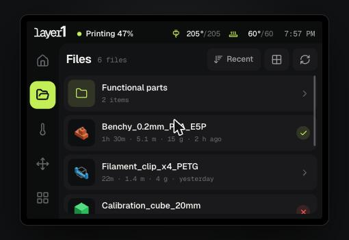

<p align="center">
  
</p>

<h3 align="center">Layer1</h3>
<p align="center">A Bambu-style touchscreen UI for the Ender 5 Pro</p>

<p align="center">
  
</p>

---

Layer1 is a full-screen touch interface that runs on a 3.5" Raspberry Pi screen
through OctoPrint. It turns a bare Ender 5 Pro into something that feels like a
modern printer with a built-in display.

<p align="center">
  &nbsp;
  
</p>
<p align="center">
  &nbsp;
  
</p>

## Features

- **Live camera** with tap-to-fullscreen and a 3D G-code viewer
- **Print progress** with layer gauge, time remaining, and ETA
- **Temperature control** with quick presets (PLA, PETG, TPU, ABS) and a keypad
- **File browser** with slicer thumbnails, folders, sort options, and grid/list view
- **Jog controls** for XY, Z (bed), and extruder with configurable steps
- **Filament management** — load, unload, and purge with Bowden-length support
- **Tune while printing** — speed modes, flow rate, and part fan
- **Network page** — tap the Wi-Fi icon for the network name, signal, and IP, plus QR codes that open OctoPrint and Layer1 on your phone
- **Dark and light themes** optimized for small SPI panels
- **Fully offline** — fonts, icons, and assets are all bundled

## How it works

```
Raspberry Pi (OctoPi)
├── 3.5" SPI screen ← X11 (no desktop) ← Chromium kiosk
│                       └── http://127.0.0.1/plugin/layer1/
├── OctoPrint + Layer1 plugin (serves the touch UI)
│     └── REST API + push socket, authenticated via app key
└── USB → Ender 5 Pro
```

The plugin only serves static files — every printer action goes through
OctoPrint's normal API, so permissions, safety checks, and your existing
plugins all still apply.

## Quick start

**Try it on your PC** (no printer needed):

```bash
cd ender-5-pro/touch-ui/octoprint_layer1/static
python -m http.server 8765
# Open http://localhost:8765/index.html?demo=printing
```

**Install on the Pi** — see the full setup guide:
[ender-5-pro/README.md](ender-5-pro/README.md)

## Project structure

```
ender-5-pro/
├── touch-ui/          OctoPrint plugin that serves the web app
├── pi-setup/          Shell scripts: screen driver, kiosk service, diagnostics
├── deploy.ps1         Deploy from Windows to the Pi over SSH
└── docs/              Screen setup guides and screenshots
```

## License

Geist fonts: [SIL OFL 1.1](ender-5-pro/touch-ui/octoprint_layer1/static/fonts/LICENSE-geist.txt) · Lucide icons: [ISC](ender-5-pro/touch-ui/octoprint_layer1/static/js/icons.LICENSE.txt)
