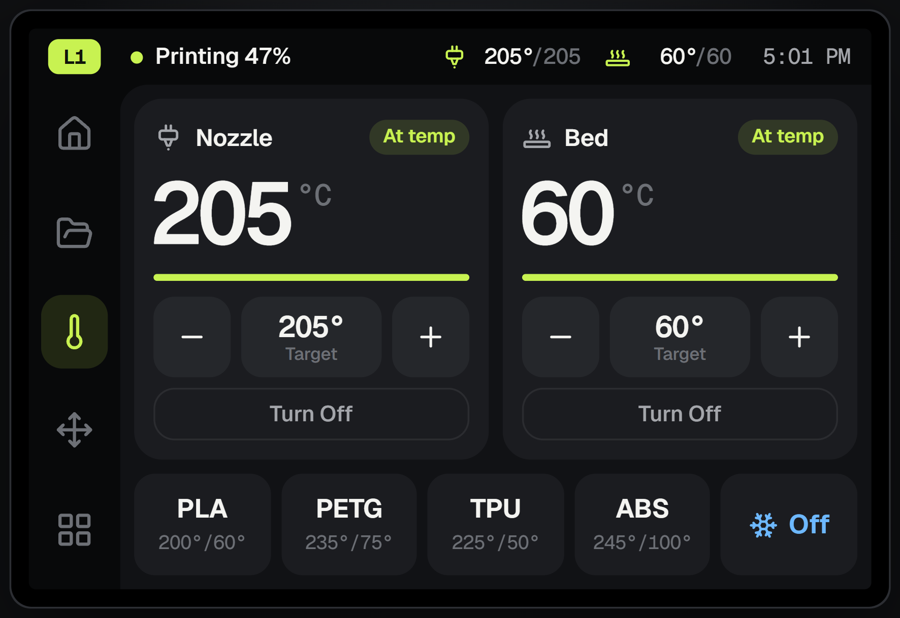
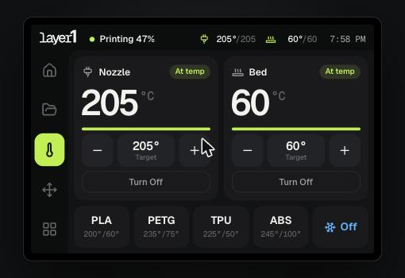
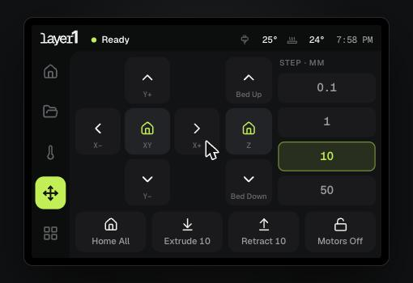
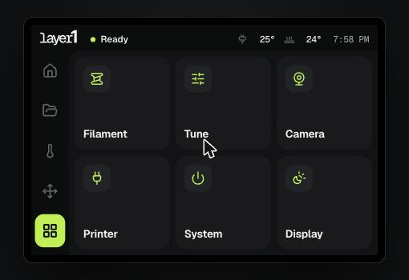

<p align="center">
  
</p>

<h3 align="center">Layer1</h3>
<p align="center">A full-screen touch UI for OctoPrint</p>

<p align="center">
  
</p>

---

Layer1 is a full-screen touch interface for OctoPrint. It gives any printer the kind of
built-in display you'd expect on a much newer machine. It was made for a 3.5" screen on the
Raspberry Pi, and the layout grows to fill whatever it opens on: a 5" or 7" display, a
tablet, or a phone turned sideways.

<p align="center">
  &nbsp;
  
</p>
<p align="center">
  &nbsp;
  
</p>

## Features

- **Live camera** with tap-to-fullscreen and a 3D G-code viewer
- **Print progress** with layer gauge, time remaining, and ETA
- **Temperature control** with quick presets (PLA, PETG, TPU, ABS) and a keypad
- **Temperature graphs:** a 10-minute sparkline on each heater; tap it for nozzle and bed over 5, 10 or 30 minutes, and drag to read any moment
- **File browser** with slicer thumbnails, folders, sort options, and grid/list view
- **Jog controls** for XY, Z (bed), and extruder with configurable steps
- **Filament management:** load, unload, and purge with Bowden-length support
- **Tune while printing:** speed modes, flow rate, and part fan
- **Print history:** every print that finished, failed, or was stopped, with totals and Print Again (earlier prints are imported from OctoPrint)
- **Lock screen:** shows the print big from across the room; hold to unlock, with optional auto-lock after 1, 5, or 15 minutes
- **Print finished card:** a camera photo of the part, time taken vs. the estimate, filament used, bed cool-down, and Print Again
- **Screen sleep:** goes dark after 2–30 minutes without a touch; a tap wakes it, and so does a print finishing, failing, or pausing
- **Network page:** tap the Wi-Fi icon for Wi-Fi (name, signal bars) or Ethernet (link speed) details and the IP, plus QR codes that open OctoPrint and Layer1 on your phone
- **Dark and light themes** optimized for small SPI panels
- **Fully offline:** fonts, icons, and assets are all bundled

## How it works

```
Raspberry Pi (OctoPi)
├── 3.5" SPI screen ← X11 (no desktop) ← Chromium kiosk
│                       └── http://127.0.0.1/plugin/layer1/
├── OctoPrint + Layer1 plugin (serves the touch UI)
│     └── REST API + push socket, authenticated via app key
└── USB → Your 3D printer
```

The plugin only serves static files. Every printer action goes through
OctoPrint's normal API, so permissions, safety checks, and your existing
plugins all still apply.

## Quick start

**Try it on your PC** (no printer needed):

```bash
cd octoprint_layer1/static
python -m http.server 8765
# Open http://localhost:8765/index.html?demo=printing
```

Resize the window to see the layout adapt. At 480×320 you get exactly what the 3.5" screen shows.

**Install on the Pi.** See the full setup guide:
[docs/setup.md](docs/setup.md)

## Project structure

```
octoprint_layer1/      The OctoPrint plugin; static/ is the touch UI itself
pyproject.toml         Plugin packaging (pip installs from the repo root)
pi-setup/              Shell scripts: screen driver, kiosk service, diagnostics
tools/                 deploy.ps1 (Windows → Pi over SSH), build-icons.mjs, serve.py
docs/                  Setup guide, screen setup, screenshots
extras/layer1.md       Draft listing for the OctoPrint Plugin Repository
marketing/             The website (layer1.nodebench.com)
```

## Development

- **UI:** `http://<octopi>/plugin/layer1/`
- **Config:** `~/.octoprint/data/layer1/config.json`, created on first load. The keys are
  listed in [docs/setup.md](docs/setup.md#settings).
- **History:** `~/.octoprint/data/layer1/history.json` holds prints that ended. It is seeded
  once from OctoPrint's per-file print logs and served at `/plugin/layer1/history`.
- **Dev server:** `python tools/serve.py [port]` (default 8080) serves `octoprint_layer1/static/`
  without caching and with the custom 404 page. Open `index.html?demo`.
- **Icons:** `node tools/build-icons.mjs` regenerates `static/js/icons.js` from a pinned
  Lucide version. To add one, put `ourName: 'lucide-name'` in that script's `ICONS` list.
- **Checks:** every push and pull request is scanned with the rules of
  [octoscanner](https://github.com/jacopotediosi/octoscanner), the static checks OctoPrint's
  plugin reviewers run ([`.github/workflows/octoscanner.yml`](.github/workflows/octoscanner.yml)).
  To run the same scan locally, check out octoscanner at the commit pinned there, then:

  ```bash
  pip install semgrep
  semgrep scan --config /path/to/octoscanner/rules --error --metrics=off --no-rewrite-rule-ids .
  ```

  A finding that isn't a problem gets `# nosemgrep: RULE-ID` on its line, with the reason.

## License

Layer1 is licensed under the [GNU Affero General Public License v3.0](LICENSE) or later,
the same license as OctoPrint.

Geist fonts: [SIL OFL 1.1](octoprint_layer1/static/fonts/LICENSE-geist.txt) · Lucide icons: [ISC](octoprint_layer1/static/js/icons.LICENSE.txt)
