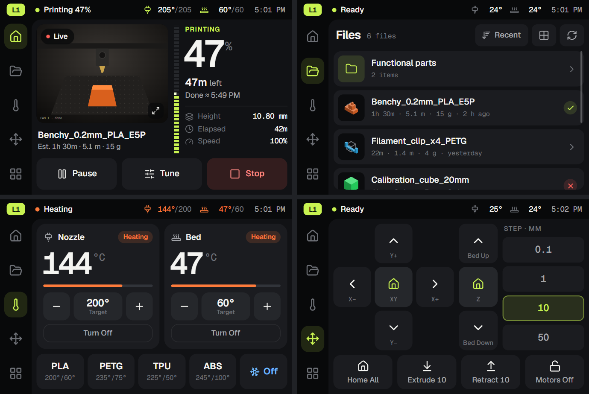

# Layer1 — Touchscreen Controller for OctoPrint

Layer1 is a full-screen touch interface for any printer OctoPrint can drive. It was made for
the 3.5" (480×320) SPI screen attached to the OctoPi Raspberry Pi, and grows to fill bigger
screens: a 5" or 7" display, a tablet, or a phone held sideways (held upright, it asks you to
turn the phone). Think Bambu-style printer screen:
live camera, a progress gauge, temperatures, file browser with thumbnails, jog
controls, filament load/unload, speed/flow/fan tuning — all driven through OctoPrint.



## How it fits together

```
┌──────────── Raspberry Pi (OctoPi) ──────────────────────────────────────┐
│                                                                          │
│  3.5" SPI screen ◄── X11 (no desktop) ◄── Chromium kiosk                 │
│                                              │  http://127.0.0.1/plugin/layer1/
│                                              ▼                           │
│  OctoPrint ──► plugin "Layer1": serves the touch app (static)            │
│      ▲  REST API + push socket, authenticated with an app key            │
│      └──────────── USB ──────────► Your 3D printer                       │
└──────────────────────────────────────────────────────────────────────────┘
```

* **`octoprint_layer1/`** – an OctoPrint plugin. It only serves the web app; every printer
  action goes through OctoPrint's normal API, so OctoPrint's permissions, safety
  checks and your existing plugins all still apply. The app pairs itself with
  OctoPrint using OctoPrint's *Application Keys* flow (you click **Allow** once).
* **`pi-setup/`** – shell scripts for the Pi: screen driver, kiosk service, diagnostics.
* **`tools/deploy.ps1`** – copies everything to the Pi from Windows and runs the installers.

The look: Geist for text, Geist Mono for live readings, [Lucide](https://lucide.dev)
icons. All are bundled in the plugin, so the Pi needs no internet. To add an icon, see
[Development](../README.md#development) in the main README.

Tested against OctoPrint 2.0.2 with its virtual printer: plugin loading, pairing,
the live socket, every command the UI sends, and rejected-key handling. The kiosk
and screen-driver scripts could not be tested here (no Pi), see *Status* below.

## Try it on your PC first (no printer needed)

```powershell
cd octoprint_layer1\static
python -m http.server 8765
```

Open <http://localhost:8765/index.html?demo=printing>. Other scenarios:
`?demo`, `?demo=paused`, `?demo=finished`, `?demo=heating`, `?demo=offline`,
`?demo=error`. Jump to a screen with `&page=files|heat|move|more|calibrate`, open a
page with `&sheet=temps|history|maintenance|lock|locked|finished|asleep` (and the others listed at
the top of `app.js`), and add `&theme=light` for the light theme.
Resize the window to see the layout adapt; at 480×320 it is exactly what the 3.5" screen shows.

## Install on the Pi

You need SSH access to the Pi (`ssh pi@octopi.local`). Four steps:

### 1. Get the screen working (once)

Copy the project over and set up the screen driver. The built-in `piscreen` driver
works for most ILI9486 + XPT2046 3.5" screens (Waveshare (A) and its clones):

```powershell
.\tools\deploy.ps1                # copies files to ~/layer1 and installs the plugin
ssh pi@octopi.local
sudo bash ~/layer1/pi-setup/setup-screen.sh piscreen
sudo reboot
```

After the reboot, check it:

```bash
sudo bash ~/layer1/pi-setup/check-screen.sh test
```

You should see coloured static on the small screen for 2 seconds. If not, see
[screen-setup.md](screen-setup.md) (Waveshare's own driver, rotation, clones).

### 2. Install the plugin

`tools/deploy.ps1` already did this. To do it by hand on the Pi:

```bash
bash ~/layer1/pi-setup/install-plugin.sh
```

Check it in any browser: <http://octopi.local/plugin/layer1/>.

### 3. Install the kiosk

```powershell
.\tools\deploy.ps1 -Kiosk
```

or on the Pi: `sudo bash ~/layer1/pi-setup/install-kiosk.sh`.
This installs a minimal X server and Chromium (no desktop) and a systemd service
that starts the UI on the small screen at boot.

### 4. Pair and calibrate

1. The screen shows **Pair this screen with OctoPrint**. Open OctoPrint on your
   PC or phone, log in, and click **Allow** on the *Layer1* request.
2. If taps land in the wrong place: `sudo layer1-kiosk calibrate`, tap the four
   crosshairs, then run the `sudo layer1-kiosk set-touch "…"` command the screen
   shows. Quick fixes for swapped/mirrored axes:
   `sudo layer1-kiosk rotate-touch 90|180|270|swap|invert-x|invert-y`.

## Using it

| Screen | What's there |
|---|---|
| **Home** | Camera (tap for full screen; *Live/3D* switches to a 3D view drawn from the G-code: printed layers solid, the layer being printed highlighted, the rest faint (the last print when idle). Tap it for full screen and drag to rotate. Files on the SD card or over 64 MB show the slicer picture instead. The choice is remembered), the layer-stack progress gauge, time left and finish time, height, speed. Pause / Tune / Stop while printing; Preheat / Home / Print when idle; Print Again after a finish. |
| **Files** | OctoPrint's library with thumbnails, folders, a sort picker (*Recent*, *Name*, or print time *Shortest* / *Longest*), and a list or grid (gallery) view; the button next to Refresh switches, and both choices are remembered. Tap a file for details, then **Print**. |
| **Heat** | Nozzle and bed: ±5° buttons, tap the target for a keypad, presets (PLA, PETG, TPU, ABS, Cool). |
| **Move** | XY pad, Z (*Z+ / Z−*, or *Bed Up / Bed Down* with `printer.zMovesBed`), steps 0.1–50 mm, extrude/retract, motors off. Locked while printing. |
| **More** | Filament load/unload/purge, Tune (speed modes, flow, part fan), Camera, History, Maintenance (tasks due after so many hours of printing; the rail's More button gets a dot while one is due, and **Mark Done** starts its count again), Printer connection, System (restart/reboot/shut down, unpair), Display (dark/light theme, touch calibration), Lock. |
| **Status bar** | Tap it anywhere for **Quick info**: nozzle and bed (state, temperature, target), the job (percent, time left, finish time; the last print when idle), fan / speed / flow / Z, the printer connection (port, baud), the network (address, IP, Wi-Fi signal) and the Pi (CPU temperature, under-voltage or throttling, free disk, uptime). Read-only: tap anywhere to close; it also closes by itself after `ui.quickInfoSeconds`. |

Thumbnails come from your slicer via the
[PrusaSlicer Thumbnails](https://plugins.octoprint.org/plugins/prusaslicerthumbnails/)
OctoPrint plugin (works with PrusaSlicer, OrcaSlicer, SuperSlicer and Cura). Without it
the UI shows a placeholder.

## Settings

**Layer1** — OctoPrint → Settings → Layer1 has a form for most of these. When you save, open
screens reload by themselves. The keys marked *config.yaml* aren't in the form:
set them in OctoPrint's `~/.octoprint/config.yaml` under `plugins: layer1:` and restart
OctoPrint, for example

```yaml
plugins:
  layer1:
    move:
      steps: [0.1, 1, 10, 50]
    speedModes:
    - {name: Quiet, factor: 50}
    - {name: Normal, factor: 100}
```

Earlier versions kept these in `~/.octoprint/data/layer1/config.json`. If that file is there,
Layer1 copies whatever differs from the defaults into OctoPrint's settings once, at startup,
and renames it `config.json.imported`. The build volume and origin aren't copied: they come
from OctoPrint's printer profile.

| Key | Default | Meaning |
|---|---|---|
| `printer.name` | from OctoPrint | Shown on Home, the lock screen and the pairing screen. Empty uses the name of OctoPrint's printer profile (Settings → Printer Profiles) |
| `printer.buildVolume` / `origin` | from OctoPrint | `[width, depth, height]` in mm and `lowerleft` or `center`. Empty uses OctoPrint's printer profile, which is the place to set them. Level Bed and After Print use them to stay inside the bed *(config.yaml)* |
| `printer.zMovesBed` | false | Set `true` if Z moves the bed rather than the nozzle (most CoreXY printers): Move then labels Z *Bed Up / Bed Down* and After Print says *Lower Bed* instead of *Raise Z* |
| `presets` | PLA 200/60, PETG 235/75, TPU 225/50, ABS 245/100 | Material presets (nozzle/bed °C) |
| `limits.nozzleMax` / `bedMax` | 250 / 100 | Highest target the UI allows. Hotends with a PTFE-lined throat shouldn't go above ~250 °C; raise it if yours is all-metal. |
| `limits.minExtrudeTemp` | 170 | Below this, extrude/retract are refused (Marlin's cold-extrusion limit) |
| `filament.bowdenLength` | 420 | **Measure yours.** Load feeds this minus `fastFeedStopShort` fast, then purges slowly. On a direct-drive extruder set it to the extruder-to-nozzle length (a few tens of mm) |
| `filament.fastFeed` / `purgeFeed` | 1500 / 240 | mm/min. Many stock firmwares cap E at 25 mm/s (1500) |
| `move.steps` | 0.1, 1, 10, 50 | Step sizes (mm) on Move. The chosen step is both the jog distance and the extrude/retract length *(config.yaml)* |
| `level.inset` | 30 | Move → Level Bed: how far (mm) the corner spots sit in from the bed's edges. Set it so the nozzle stops over each knob |
| `level.paperZ` / `clearance` | 0 / 5 | Z (mm) for the paper test, and how far Z goes up before moving between spots and when you leave the page *(config.yaml)* |
| `afterPrint.coolDown` / `lowerBed` | true / true | Tune → After Print: switch heaters, fan and motors off, and move Z up (drop the bed or raise the nozzle), after every print that finishes. A choice made on the screen wins *(config.yaml)* |
| `afterPrint.lowerBedBy` | 100 | How far (mm) Z goes up. It never goes past the top of the build volume |
| `afterPrint.shutdownSeconds` | 60 | Shut Down Pi (*Shut Down System* when OctoPrint isn't on a Pi): the countdown before it shuts down, which the screen can cancel. Uses OctoPrint's shutdown command (Settings → Server → Commands) |
| `maintenance.tasks` | Lubricate Z screw 100, Check belt tension 100, Check screws and wheels 200, Replace nozzle 500 | More → Maintenance: each task (`name`, `hours`) is due after that many hours of printing, counted from the print history since it was last marked done. A new task starts at 0 h. Tasks are matched by name, so renaming one starts its count again |
| `speedModes` | Quiet 50, Normal 100, Sport 125, Turbo 150 | Feed-rate presets (M220) *(config.yaml)* |
| `webcam.snapshot` / `stream` | `/webcam/?action=snapshot` / `…stream` | OctoPi's default webcam URLs |
| `webcam.snapshotSeconds` | 3 | Home screen refresh. The live stream is only used full-screen, to spare the SPI screen |
| `webcam.flipH` / `flipV` / `rotate90` | false | Camera orientation |
| `ui.clock24` | false | 24-hour clock |
| `ui.quickInfoSeconds` | 15 | Quick info (tap the status bar) closes itself after this many seconds. `0` keeps it open until tapped *(config.yaml)* |
| `ui.autoLockMinutes` | 0 | Lock the screen after this many minutes without a touch. `0` never does. A choice made on the screen (More → Lock) wins |
| `ui.sleepMinutes` | 0 | Turn the screen black after this many minutes without a touch (most SPI panels can't switch the backlight off). `0` never does. A choice made on the screen (More → Display) wins |
| `ui.brightness` | 100 | Percent, 30–100. SPI panels can't dim their backlight, so this darkens the picture with a black layer (the backlight stays on). A choice made on the screen (More → Display) wins *(config.yaml)* |
| `ui.theme` | dark | `dark` or `light`. Light is easier to read on cheap panels with greyish blacks. A choice made on the screen (More → Display) is remembered and wins |

**Kiosk** — `/etc/layer1-kiosk.conf` (framebuffer, touch matrix, Chromium flags).
Apply with `sudo layer1-kiosk restart`.

## Kiosk commands

```
layer1-kiosk status | logs
sudo layer1-kiosk restart | stop | start
sudo layer1-kiosk calibrate
sudo layer1-kiosk set-touch "<9 numbers>"
sudo layer1-kiosk rotate-touch 0|90|180|270|swap|invert-x|invert-y
sudo layer1-kiosk reset-touch
```

## Troubleshooting

* **Screen white or blank** — the driver isn't loaded: `sudo bash check-screen.sh`, then [screen-setup.md](screen-setup.md).
* **Screen shows the console, not the UI** — `layer1-kiosk logs`. Look for the line
  `layer1-kiosk: using /dev/fbN`. If it picked the wrong framebuffer, set `FBDEV=/dev/fb1` in `/etc/layer1-kiosk.conf`.
* **"No OctoPrint"** — OctoPrint isn't running or still starting: `sudo service octoprint status`.
* **Stuck on pairing** — the request appears only in a logged-in OctoPrint tab;
  open/refresh OctoPrint, then tap *Ask Again*. Requests expire after a while.
* **Camera offline** — check <http://octopi.local/webcam/?action=snapshot> works; adjust `webcam` URLs in the config.
* **Fan % shows "not reported yet"** — OctoPrint doesn't report fan speed; the UI learns it from the next `M106` sent.
* **Updated the plugin but the screen shows the old UI** — More → System → Reload Screen.
* **Remove the kiosk** — `sudo bash ~/layer1/pi-setup/uninstall-kiosk.sh`. The plugin: OctoPrint → Settings → Plugin Manager.

## Status

| Part | Tested |
|---|---|
| Layer1 in a browser (every screen, demo mode) | ✅ Chrome at 480×320; headless Chromium at 800×480, 1024×600, 844×390 (phone sideways) and 1440×900 |
| Plugin + UI against real OctoPrint 2.0.2 (virtual printer): pairing, socket, commands, bad-key → re-pair | ✅ |
| UI on a real 3.5" panel (Pi 4, Raspberry Pi OS trixie, LCD-show `tft35a`, Chromium kiosk, demo mode) | ✅ Renders 1:1 on the ILI9486 panel. Touch not checked yet |
| Kiosk service, X11 on the SPI framebuffer, touch matrix | ⚠️ Written for Raspberry Pi OS (Bullseye/Bookworm), not yet run on a Pi |
| `setup-screen.sh` overlays | ⚠️ Depends on your exact screen; the doc lists fallbacks |
| Filament load/unload lengths | ⚠️ Measure your Bowden tube before the first load |
