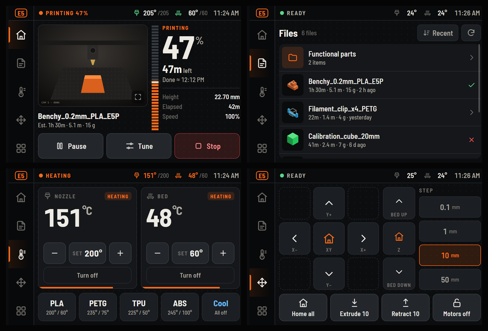

# Ender 5 Pro — Raspberry Pi Based Touchscreen Controller

A full-screen touch interface for the Ender 5 Pro, running on the 3.5" (480×320)
SPI screen attached to the OctoPi Raspberry Pi. Think Bambu-style printer screen:
live camera, a progress gauge, temperatures, file browser with thumbnails, jog
controls, filament load/unload, speed/flow/fan tuning — all driven through OctoPrint.



## How it fits together

```
┌──────────── Raspberry Pi (OctoPi) ──────────────────────────────────────┐
│                                                                          │
│  3.5" SPI screen ◄── X11 (no desktop) ◄── Chromium kiosk                 │
│                                              │  http://127.0.0.1/plugin/ender5touch/
│                                              ▼                           │
│  OctoPrint ──► plugin "Ender 5 Touch": serves the touch app (static)     │
│      ▲  REST API + push socket, authenticated with an app key            │
│      └──────────── USB ──────────► Ender 5 Pro                           │
└──────────────────────────────────────────────────────────────────────────┘
```

* **`touch-ui/`** – an OctoPrint plugin. It only serves the web app; every printer
  action goes through OctoPrint's normal API, so OctoPrint's permissions, safety
  checks and your existing plugins all still apply. The app pairs itself with
  OctoPrint using OctoPrint's *Application Keys* flow (you click **Allow** once).
* **`pi-setup/`** – shell scripts for the Pi: screen driver, kiosk service, diagnostics.
* **`deploy.ps1`** – copies everything to the Pi from Windows and runs the installers.

The look: Geist for text, Geist Mono for live readings, [Lucide](https://lucide.dev)
icons. All are bundled in the plugin, so the Pi needs no internet. To add an icon, see
[touch-ui/README.md](touch-ui/README.md).

Tested against OctoPrint 2.0.2 with its virtual printer: plugin loading, pairing,
the live socket, every command the UI sends, and rejected-key handling. The kiosk
and screen-driver scripts could not be tested here (no Pi), see *Status* below.

## Try it on your PC first (no printer needed)

```powershell
cd ender-5-pro\touch-ui\octoprint_ender5touch\static
python -m http.server 8765
```

Open <http://localhost:8765/index.html?demo=printing>. Other scenarios:
`?demo`, `?demo=paused`, `?demo=finished`, `?demo=heating`, `?demo=offline`,
`?demo=error`. Jump to a screen with `&page=files|heat|move|more|calibrate`.
Make the browser window 480×320 to see it at real size.

## Install on the Pi

You need SSH access to the Pi (`ssh pi@octopi.local`). Four steps:

### 1. Get the screen working (once)

Copy the project over and set up the screen driver. The built-in `piscreen` driver
works for most ILI9486 + XPT2046 3.5" screens (Waveshare (A) and its clones):

```powershell
.\deploy.ps1                      # copies files to ~/ender5-touch and installs the plugin
ssh pi@octopi.local
sudo bash ~/ender5-touch/pi-setup/setup-screen.sh piscreen
sudo reboot
```

After the reboot, check it:

```bash
sudo bash ~/ender5-touch/pi-setup/check-screen.sh test
```

You should see coloured static on the small screen for 2 seconds. If not, see
[docs/screen-setup.md](docs/screen-setup.md) (Waveshare's own driver, rotation, clones).

### 2. Install the plugin

`deploy.ps1` already did this. To do it by hand on the Pi:

```bash
bash ~/ender5-touch/pi-setup/install-plugin.sh
```

Check it in any browser: <http://octopi.local/plugin/ender5touch/>.

### 3. Install the kiosk

```powershell
.\deploy.ps1 -Kiosk
```

or on the Pi: `sudo bash ~/ender5-touch/pi-setup/install-kiosk.sh`.
This installs a minimal X server and Chromium (no desktop) and a systemd service
that starts the UI on the small screen at boot.

### 4. Pair and calibrate

1. The screen shows **Pair this screen with OctoPrint**. Open OctoPrint on your
   PC or phone, log in, and click **Allow** on the *Ender 5 Pro touchscreen* request.
2. If taps land in the wrong place: `sudo ender5-kiosk calibrate`, tap the four
   crosshairs, then run the `sudo ender5-kiosk set-touch "…"` command the screen
   shows. Quick fixes for swapped/mirrored axes:
   `sudo ender5-kiosk rotate-touch 90|180|270|swap|invert-x|invert-y`.

## Using it

| Screen | What's there |
|---|---|
| **Home** | Camera (tap for full screen; *Live/Model* toggles to the slicer thumbnail), the layer-stack progress gauge, time left and finish time, height, speed. Pause / Tune / Stop while printing; Preheat / Home / Print when idle; Print again after a finish. |
| **Files** | OctoPrint's library with thumbnails, folders, *Recent / A–Z*. Tap a file for details, then **Print**. |
| **Heat** | Nozzle and bed: ±5° buttons, tap the target for a keypad, presets (PLA, PETG, TPU, ABS, Cool). |
| **Move** | XY pad, Z (labelled *Bed up / Bed down*, because on the Ender 5 the bed moves), steps 0.1–50 mm, extrude/retract, motors off. Locked while printing. |
| **More** | Filament load/unload/purge, Tune (speed modes, flow, part fan), Camera, Printer connection, System (restart/reboot/shut down, unpair), Touch calibration. |

Thumbnails come from your slicer via the
[PrusaSlicer Thumbnails](https://plugins.octoprint.org/plugins/prusaslicerthumbnails/)
OctoPrint plugin (works with PrusaSlicer, OrcaSlicer, SuperSlicer and Cura). Without it
the UI shows a placeholder.

## Settings

**Touch UI** — `~/.octoprint/data/ender5touch/config.json` on the Pi (created the
first time the UI loads). Edit, then reload the screen (More → System → Reload screen).

| Key | Default | Meaning |
|---|---|---|
| `presets` | PLA 200/60, PETG 235/75, TPU 225/50, ABS 245/100 | Material presets (nozzle/bed °C) |
| `limits.nozzleMax` / `bedMax` | 250 / 100 | Highest target the UI allows. The stock Ender 5 Pro hotend has a PTFE-lined throat, so don't go above ~250 °C. |
| `limits.minExtrudeTemp` | 170 | Below this, extrude/retract are refused (Marlin's cold-extrusion limit) |
| `filament.bowdenLength` | 420 | **Measure yours.** Load feeds this minus `fastFeedStopShort` fast, then purges slowly |
| `filament.fastFeed` / `purgeFeed` | 1500 / 240 | mm/min. Stock Ender firmware caps E at 25 mm/s (1500) |
| `move.steps` / `extrudeAmount` | 0.1, 1, 10, 50 / 10 | Jog steps (mm) and extrude amount |
| `speedModes` | Quiet 50, Normal 100, Sport 125, Turbo 150 | Feed-rate presets (M220) |
| `webcam.snapshot` / `stream` | `/webcam/?action=snapshot` / `…stream` | OctoPi's default webcam URLs |
| `webcam.snapshotSeconds` | 3 | Home screen refresh. The live stream is only used full-screen, to spare the SPI screen |
| `webcam.flipH` / `flipV` / `rotate90` | false | Camera orientation |
| `ui.clock24` | false | 24-hour clock |

**Kiosk** — `/etc/ender5-kiosk.conf` (framebuffer, touch matrix, Chromium flags).
Apply with `sudo ender5-kiosk restart`.

## Kiosk commands

```
ender5-kiosk status | logs
sudo ender5-kiosk restart | stop | start
sudo ender5-kiosk calibrate
sudo ender5-kiosk set-touch "<9 numbers>"
sudo ender5-kiosk rotate-touch 0|90|180|270|swap|invert-x|invert-y
sudo ender5-kiosk reset-touch
```

## Troubleshooting

* **Screen white or blank** — the driver isn't loaded: `sudo bash check-screen.sh`, then [docs/screen-setup.md](docs/screen-setup.md).
* **Screen shows the console, not the UI** — `ender5-kiosk logs`. Look for the line
  `ender5-kiosk: using /dev/fbN`. If it picked the wrong framebuffer, set `FBDEV=/dev/fb1` in `/etc/ender5-kiosk.conf`.
* **"No OctoPrint"** — OctoPrint isn't running or still starting: `sudo service octoprint status`.
* **Stuck on pairing** — the request appears only in a logged-in OctoPrint tab;
  open/refresh OctoPrint, then tap *Ask again*. Requests expire after a while.
* **Camera offline** — check <http://octopi.local/webcam/?action=snapshot> works; adjust `webcam` URLs in the config.
* **Fan % shows "not reported yet"** — OctoPrint doesn't report fan speed; the UI learns it from the next `M106` sent.
* **Updated the plugin but the screen shows the old UI** — More → System → Reload screen.
* **Remove the kiosk** — `sudo bash ~/ender5-touch/pi-setup/uninstall-kiosk.sh`. The plugin: OctoPrint → Settings → Plugin Manager.

## Status

| Part | Tested |
|---|---|
| Touch UI in a browser (every screen, demo mode) | ✅ Chrome at 480×320 |
| Plugin + UI against real OctoPrint 2.0.2 (virtual printer): pairing, socket, commands, bad-key → re-pair | ✅ |
| UI on a real 3.5" panel (Pi 4, Raspberry Pi OS trixie, LCD-show `tft35a`, Chromium kiosk, demo mode) | ✅ Renders 1:1 on the ILI9486 panel. Touch not checked yet |
| Kiosk service, X11 on the SPI framebuffer, touch matrix | ⚠️ Written for Raspberry Pi OS (Bullseye/Bookworm), not yet run on a Pi |
| `setup-screen.sh` overlays | ⚠️ Depends on your exact screen; the doc lists fallbacks |
| Filament load/unload lengths | ⚠️ Measure your Bowden tube before the first load |
